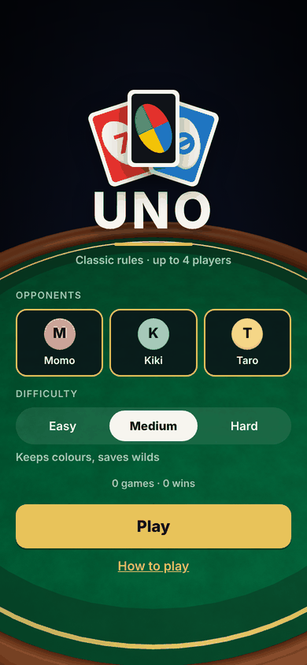
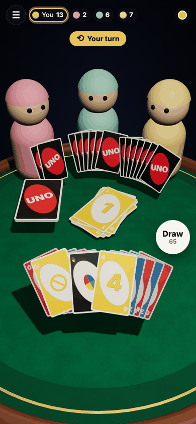
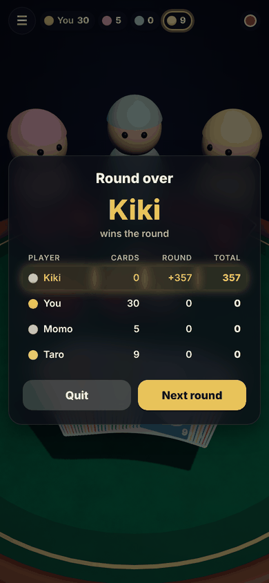

# UNO in web

A browser UNO (Classic rules) against one to three bots, playable on a phone. pnpm monorepo:
`packages/engine` is the pure-TS rules engine (zero runtime deps, event-sourced, deterministic
replay); `packages/app` is the Vite + React Three Fiber client with a 3D table, a DOM HUD,
synthesised sound and haptics.

| Lobby                                | Table (portrait)                              | Round over                                     |
| ------------------------------------ | --------------------------------------------- | ---------------------------------------------- |
|  |  |  |

```bash
pnpm install
pnpm test                       # engine 127 + app 343 + scripts 28 Vitest specs
pnpm --filter @uno/app dev      # http://localhost:5173 — open on your phone via LAN IP
pnpm --filter @uno/app build && pnpm --filter @uno/app preview
```

Every gate CI runs (`.github/workflows/ci.yml`) is a one-liner here too: `pnpm lint`,
`pnpm format:check`, `pnpm typecheck`, `pnpm test`, `pnpm --filter @uno/engine test:cov`,
`pnpm --filter @uno/app validate:assets`, `pnpm --filter @uno/app build`,
`pnpm audit --audit-level=moderate`.

Headless smoke test (needs Playwright and a running preview on :4173):

```bash
node scripts/smoke.mjs          # screenshots to $OUT (default /tmp/shots), exits non-zero on console errors
```

## Status

- **v0.3.0** — Milestone 1 (Classic rules, three bot levels, 3D table) plus the visual and
  game-flow polish described in `docs/design/polish-v0.3.md`: lounge table, drawn card art on
  one atlas, hand states and arc motion, orientation-aware camera, player strip / action
  column / callouts, pause that pauses, rules / settings / round-over sheets, lobby, sound and
  haptics, persisted stats. Before / after screenshots: `docs/design/baseline/` and
  `docs/design/v0.3/`.
- Production deploys automatically from `main` via Vercel's Git integration; previews on
  every PR. The tag-driven GitHub Actions path (`v*`) is optional and dormant until its three
  repository secrets exist. See `docs/environments.md`.
- Open polish items are listed under "Known issues" in `CHANGELOG.md`.

## Layout

- `packages/engine/src/types.ts` — state / action / event / RulePlugin contracts
- `packages/engine/src/reducer.ts` — `createEngine(registry)`; see header comment for the reducer ↔ plugin turn-flow contract
- `packages/engine/src/rules/classic.ts` — official Classic deck + card effects
- `packages/engine/src/bots/` — easy / medium / hard heuristic bots (see only `PublicView`)
- `packages/app/src/store/gameStore.ts` — Zustand slice wrapping `engine.apply`, keeps `actionLog` for save/replay, `paused` flag
- `packages/app/src/game/botDriver.ts` — all timing: bot delays, human UNO timer, bot catch rolls; schedules nothing while paused
- `packages/app/src/scene/` — R3F scene: `Scene.tsx` (canvas, camera pose, lights), `Table.tsx`, `Opponent.tsx`, `TableContents.tsx` (cards + seats), `layout.ts` + `handFan.ts` + `cameraPose.ts` (pure state → transforms, viewport-aware), `CardMesh.tsx` + `cardMotionStep.ts` (rounded card, glow, arc flight), `cardAtlas.ts` + `cardGlyphs.ts` + `cardTextures.ts` (drawn faces on one atlas), `environment.ts` (scene tokens)
- `packages/app/src/theme/` + `public/assets/cards/manifest.json` — card asset contract (atlas grid, per-variant); the drawn atlas uses the same `classicFaceToCell` / `cellToUv` mapping
- `packages/app/src/ui/` — DOM HUD and lobby: `PlayerStrip`, `ActionColumn`, `TurnBanner`, `Callouts`, `Toasts`, sheets (`PauseMenu`, `RulesSheet`, `SettingsSheet`, `ChallengeSheet`, `RoundOverSheet`) over a shared `Sheet` with focus trap + `inert`; pure helpers (`callouts.ts`, `roundSummary.ts`, `playerChips.ts`, `eventCursor.ts`) are spec'd
- `packages/app/src/audio/` — Web Audio cues (`sfx.ts`), event → cue mapping (`cues.ts`), haptics
- `packages/app/src/persistence/` — validated `localStorage` settings and stats
- `packages/app/src/styles.css` — all design tokens on `:root`; no colour, size or radius literal elsewhere
- `docs/design/` — design proposals and screenshots (the Design Origin for UI changes)
